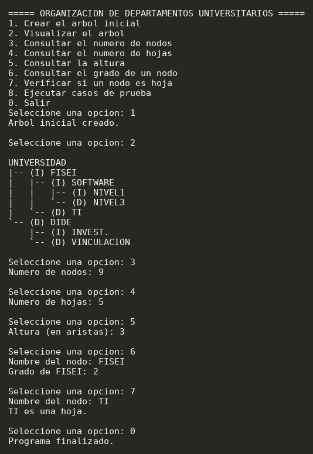
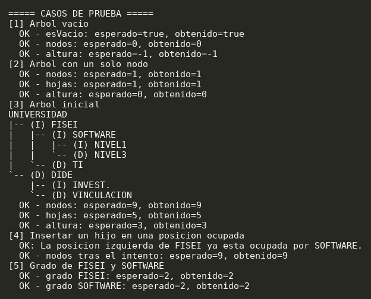

# T6-ArbolBinario-ChicoJuan

## Descripcion
Aplicacion Java que representa la organizacion jerarquica de los departamentos de una universidad mediante un arbol binario. Cada nodo guarda el nombre de una dependencia y tiene como maximo dos hijos. El programa permite construir, visualizar y analizar la estructura desde un menu interactivo.

## Estructura del arbol
```
UNIVERSIDAD
|-- (I) FISEI
|   |-- (I) SOFTWARE
|   |   |-- (I) NIVEL1
|   |   `-- (D) NIVEL3
|   `-- (D) TI
`-- (D) DIDE
    |-- (I) INVEST.
    `-- (D) VINCULACION
```
El arbol inicial tiene 9 nodos, 5 hojas y una altura de 3 aristas.

## Estructura del proyecto
Arquitectura en 3 paquetes:
- `Java/src/modelo/Nodo.java`: nodo generico `Nodo<T>` con dato, hijo izquierdo y hijo derecho.
- `Java/src/negocio/ArbolBinario.java`: insercion, busqueda, conteo de nodos y hojas, altura y visualizacion.
- `Java/src/app/Main.java`: menu con `Scanner` y casos de prueba.

Las operaciones de conteo y altura son recursivas. No se usan `TreeSet`, `TreeMap`, `PriorityQueue`, `NavigableSet` ni `NavigableMap`.

## Diagrama de clases
Ver `diagramas/diagrama-clases.md`

## Como ejecutar
Requiere JDK 11 o superior. Desde la carpeta `Java`:

```
javac -encoding UTF-8 -d out src/modelo/Nodo.java src/negocio/ArbolBinario.java src/app/Main.java
java -cp out app.Main
```

Tambien se puede abrir la carpeta `Java` en IntelliJ IDEA, marcar `src` como Sources Root y ejecutar `app.Main`.

## Menu
| Opcion | Accion |
|---|---|
| 1 | Crear el arbol inicial |
| 2 | Visualizar el arbol |
| 3 | Consultar el numero de nodos |
| 4 | Consultar el numero de hojas |
| 5 | Consultar la altura |
| 6 | Consultar el grado de un nodo |
| 7 | Verificar si un nodo es hoja |
| 8 | Ejecutar casos de prueba |
| 0 | Salir |

Los nombres de nodo se escriben sin importar mayusculas o minusculas (por ejemplo `fisei`).

## Resultados
Casos de prueba obligatorios (opcion 8):

| Caso | Esperado | Obtenido |
|---|---|---|
| Arbol vacio | 0 nodos, altura -1 | 0 nodos, altura -1 |
| Arbol con un solo nodo | 1 nodo, 1 hoja, altura 0 | 1 nodo, 1 hoja, altura 0 |
| Arbol inicial | 9 nodos, 5 hojas, altura 3 | 9 nodos, 5 hojas, altura 3 |
| Insertar en posicion ocupada | IllegalStateException | La posicion izquierda de FISEI ya esta ocupada por SOFTWARE. |
| Grado de FISEI y SOFTWARE | 2 y 2 | 2 y 2 |

## Capturas

Ejecucion del menu (opciones 1 a 7):



Casos de prueba (opcion 8):



## Autor
Chico Yunda Juan Carlos
